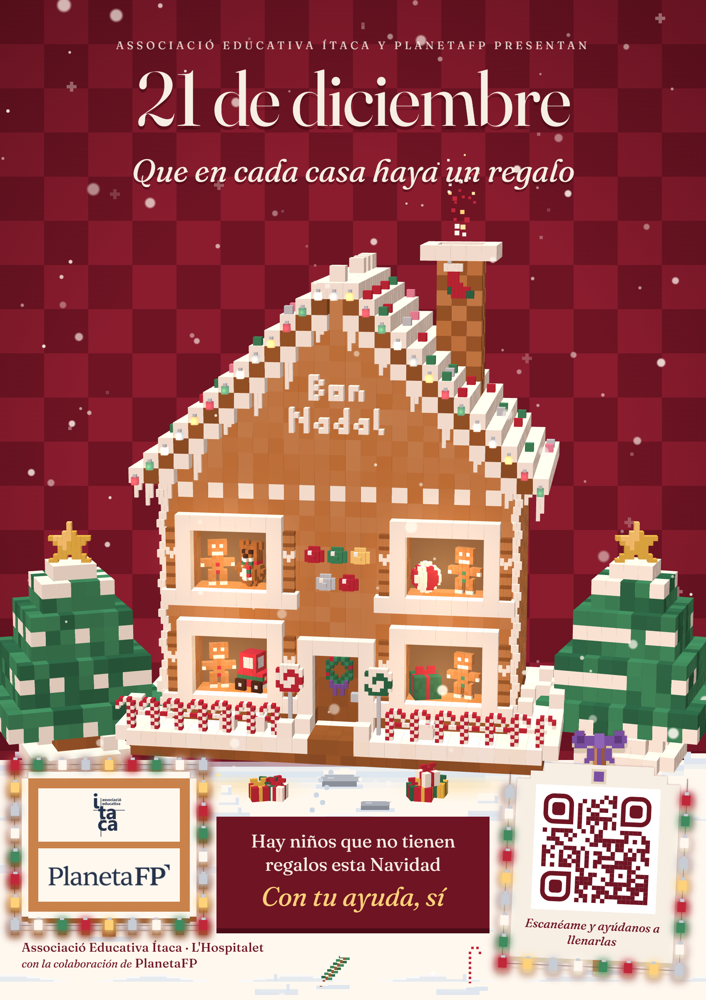

# 21 de diciembre · Que en cada casa haya un regalo

Cartel interactivo para la campaña de la **Associació Educativa Ítaca** (L'Hospitalet), con la colaboración de **PlanetaFP**, para que los niños y niñas en riesgo de exclusión tengan un regalo esta Navidad.



## Concepto

Una casita de jengibre hecha de cubitos (vóxel), tierna y colorida, sobre un fondo de cuadros vino. Tiene cuatro ventanas apagadas y en cada una vive un muñequito de jengibre que todavía no tiene regalo. Con el ratón, quien mira el cartel va encendiendo las ventanas y en cada casa aparece un regalo. Así se cuenta la idea de la campaña: *que en cada casa haya un regalo*.

Cuando las cuatro ventanas están encendidas, la chimenea echa chispitas, salen regalitos que se amontonan delante de la puerta y aparece el mensaje final:

> Hay niños que no tienen regalos esta Navidad
> **Con tu ayuda, sí**

El código QR de la etiqueta lleva a la página para colaborar.

## Estructura

```
THE_INTERACTIVE_POSTER/
├── index.html        textos, pie con logos y QR, y el canvas de la escena
├── CSS/style.css     maquetación (848 × 1200 px que se escalan sin deformarse) y animaciones CSS
├── JS/main.js        escena 3D con Three.js, nieve, eventos del ratón y estado final
└── IMG/              Logo_Aeitaca.webp, Logo_PlanetaFP.webp, qr.svg y captura-final.png
```

## Cómo verlo

Abre `index.html` en el navegador (con doble clic basta). Necesita conexión a internet para cargar Three.js y la tipografía. No hay clics ni sonido: todo funciona solo con el ratón.

## Animación que va sola

- **Nieve**: copos redondos de tamaños y opacidades distintos que caen con un leve vaivén, unos por delante y otros por detrás de la casa.
- **La casa flota** levemente; su sombra en la nieve se aclara cuando sube.
- **Bombillitas** del tejado y de los carteles que se encienden al azar y, de vez en cuando, todas a la vez.
- **Brillitos** que titilan en la nieve.

## Eventos usados

| Evento | Dónde | Para qué |
|---|---|---|
| `mousemove` | el cartel | posición del ratón: giro de la casa, cursor de manga pastelera, rastro de glaseado y qué ventana hay debajo |
| `mouseenter` | el cartel | empieza a seguir el ratón |
| `mouseleave` | el cartel | la casa vuelve al frente, desaparece la manga y la ventana que estaba encendida baja a brillo suave |

Las ventanas están dentro de la escena 3D, así que su «entrar» y «salir» se calcula con un **raycaster**. En cada fotograma se lanza un rayo desde la cámara hacia el ratón y se mira qué ventana toca. Cuando cambia la ventana bajo el cursor, la anterior recibe su *mouseleave* y la nueva su *mouseenter*. Así funciona también aunque la casa se mueva bajo un ratón quieto.

## Las tres interacciones

### 1. Mover el ratón (`mousemove`)
- La casa **gira un poco** hacia el cursor, con un movimiento suavizado.
- El cursor es una **manga pastelera** en pixel art. La punta de su boquilla es la punta del ratón.
- La boquilla deja un **rastro de gotitas de glaseado** que gotean y se desvanecen en menos de un segundo.

### 2. Entrar en una ventana (*mouseenter*)
- La ventana **se enciende con luz cálida**, ilumina al muñequito y deja un reflejo en la nieve.
- La primera vez **aparece su regalo con un saltito**: un osito, un balón, un coche o una caja con lazo. El muñequito salta de alegría.

### 3. Salir de la ventana (*mouseleave*)
- La luz **baja a un brillo suave** y el regalo se queda.
- Con **las cuatro ventanas encendidas** llega el estado final: chispitas en la chimenea, regalitos que salen en arco y se apilan a cada lado de la puerta, y el mensaje final. Es el estado final y no tiene vuelta atrás. Para volver a empezar, recarga la página.

## Paleta

| Uso | Color |
|---|---|
| Fondo / cuadros | `#6e1423` / `#8a1c2e` |
| Galleta / sombras de galleta | `#c9824a` / `#9a5a2c` |
| Glaseado y nieve | `#fff8ef` |
| Rojo, verde, plata | `#c0283a`, `#2e6b4a`, `#c8ccd4` |
| Luz de ventanas | `#ffd27a` |
| Textos | `#f7efe4` |

## Créditos técnicos

- [Three.js](https://threejs.org/) r128 (licencia MIT), desde cdnjs.
- Tipografía [Fraunces](https://fonts.google.com/specimen/Fraunces) (SIL Open Font License), desde Google Fonts.
